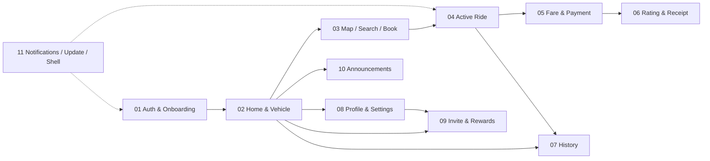

# Feature Inventory

> Features are derived from the actual code (`lib/routes/app_pages.dart`, the
> `lib/presentation/screens/*` folders, and `lib/services/*`), not from any
> template list. Priority is assigned by position in the primary user journey
> and by business criticality.

Evidence: **[SRC]** unless noted. No screenshots/emulator available (see README §2).

---

## 1. Routing & navigation summary

- Router: GetX. `GetMaterialApp(initialRoute: '/splash', defaultTransition: Transition.cupertino, transitionDuration: 500ms)` — `lib/app/root_main.dart:24-33`.
- Route table: `lib/routes/app_pages.dart:64-160`.
- Route constants: `lib/routes/app_pages.dart:41-62`.
- DI is route-based (`binding:`/`bindings:`); app-lifetime controllers registered in `lib/app/service.dart` (`AppLogic`, `BookingSession`, `NotificationLogic`).
- Shell: a single 3-tab host (`BottomNav`) hosts Home / My Booking / Profile. No drawer, no nested navigators. All other screens are pushed on the root navigator.
- Session gate: `SplashLogic._checkAuthorization` (`lib/presentation/screens/splash_screen/logic.dart:24-37`) → `/login` or `/bottomnav`.
- Global session listeners: 401 → `SessionService.handleUnauthorized()` → `/login` (`lib/services/session_service.dart:115-118`).

### Confirmed route inventory

| Route constant | Path | Screen | Binding | Notes |
|---|---|---|---|---|
| `SPLASH` | `/splash` | `SplashScreen` | `SplashBinding` | initial route |
| `LOGIN` | `/login` | `LoginPage` | `LoginBinding` | |
| `OTP` | `/otp` | `OtpPage` | `OTPBinding` | args: `phoneNumber`, `resendTime` |
| `REGISTER` | `/register` | `RegisterPage` | `RegisterBinding` | |
| `BOTTOMNAV` | `/bottomnav` | `BottomNav` | `BottomNavBinding`+`HomeBinding`+`HistoryBinding`+`ProfileBinding` | tab host |
| `HOME` | `/home` | `HomeScreen` | `HomeBinding` | defined but reached as a tab, not by route |
| `MAP` | `/map` | `MapScreen` | `MapBinding` | args: `vehicleId` |
| `BOOKING` | `/booking` | `BookingMapScreen` | `BookingMapBinding` | active ride |
| `MYBOOKING` | `/my_booking` | — | — | **constant defined, no `GetPage` registered** (`app_pages.dart:50`) |
| `CALCULATEFEE` | `/calculatefee` | `CalculateFeeScreen` | `CalculateFeeBinding` | |
| `RECEIPT` | `/receipt` | `ReceiptScreen` | `ReceiptBinding` | |
| `WHERETOGO` | `/wheretogo` | — | — | **constant defined, no `GetPage`** (`app_pages.dart:54`) |
| `DRAGMAP` | `/dragMap` | `MapDragPage` | `MapBinding`+`MapDragBinding` | args: `MapDragPurpose` |
| `TERMCONDITION` | `/termcondition` | `TermConditionPage` | `TermConditionBinding` | |
| `CONTACTUS` | `/contactus` | `ContactUsPage` | `ContactUsBinding` | |
| `INVITE_REWARDS` | `/invite-rewards` | `InviteRewardsPage` | none | app-lifetime logic in `app/service.dart` |
| `HISTORYDETAIL` | `/historydetail` | `HistoryDetailPage` | `HistoryDetailBinding` | args: `Datum` |
| `ANNOUNCEMENT` | `/announcement` | `AnnouncementPage` | `AnnouncementBinding` | |
| `ANNOUNCEMENTDETAIL` | `/announcement_detail` | `AnnouncementDetailPage` | `AnnouncementDetailBinding` | args: `id` |

> **[SRC]** `MYBOOKING` (`/my_booking`) and `WHERETOGO` (`/wheretogo`) are dead
> route constants: no `GetPage` uses them. `HomeScreen` is bound to both `/home`
> and the tab host.

---

## 2. Feature inventory (audit units)

Each audit unit groups the screens that share a user goal, with its entry points
and dependencies. Order = proposed audit order.

### Feature 01 — Authentication & Onboarding  *(audited)*
- **Purpose:** get a new or returning passenger signed in and to Home.
- **Screens:** Splash `/splash`, Login `/login`, OTP `/otp`, Register `/register`.
- **Files:** `lib/presentation/screens/{splash_screen,login,otp,register}/`, `login/data/{datasource,repository}`, `lib/services/session_service.dart`, `lib/core/helper/phone_validate_helper.dart`, `lib/core/utils/{phone_formatter,debug_auth_bypass}.dart`, `lib/translations/`.
- **Entry:** app launch (splash); 401/logout (login).
- **Exit:** `/bottomnav`.
- **Depends on:** `ApiClient`/`Result` (`core/network/`), `SessionService`, `AppLogic` (language), invite code check (D40).
- **Priority:** Critical (all else is unreachable until this passes).
- **Status:** ✅ audited — `features/01_authentication_onboarding.md`.

### Feature 02 — Home & Vehicle Selection
- **Purpose:** choose a ride type / start a booking.
- **Screens:** Home tab (index 0).
- **Files:** `lib/presentation/screens/home/` (`view.dart`, `logic.dart`, `state.dart`, `booking_redirect.dart`), `lib/data/datasources/get_vehical_remote_data_source.dart`, `lib/data/models/vehical_model.dart`, `lib/core/utils/{vehicle_art,vehicle_kind,vehicle_cell_data,fare_estimate}.dart`.
- **Entry:** tab 0 after auth; return from trips.
- **Exit:** `/map` (with `vehicleId`); announcement bell (currently commented out); invite FAB.
- **Depends on:** socket setup (`AppLogic.initSocket`), location permission (`LocationService`), `checkBookingStatus` → `/booking` or `/calculatefee`.
- **Priority:** Critical.
- **Status:** ⏳ pending.

### Feature 03 — Map, Location Search & Booking Request
- **Purpose:** pick pickup/destination on a map and send a booking request.
- **Screens:** Map `/map`; Search/DragMap `/dragMap`; booking-request overlay over Map; `DetailServiceDialog` (tariff).
- **Files:** `lib/presentation/screens/map_screen/`, `lib/presentation/shared/map_drag/`, `lib/app/google_map_logic.dart`, `lib/data/datasources/{places_api,driver_around_api,request_booking_api,update_passenger_location_api}.dart`, `lib/services/{location_service,location_imp}.dart`, `lib/core/utils/{load_custom_marker,trip_marker}.dart`.
- **Entry:** Home vehicle card or "Where to?".
- **Exit:** `/booking` on success; back to `/map`/`/home` on cancel.
- **Depends on:** Google Maps/Places keys (`AppConfig`), socket (`rideRequest`), `BookingSession`.
- **Priority:** Critical.
- **Status:** ⏳ pending.

### Feature 04 — Active Ride Tracking
- **Purpose:** watch the driver arrive, ride, and drop off.
- **Screens:** Booking `/booking`.
- **Files:** `lib/presentation/screens/booking_map_screen/`, `widgets/booking_sheet.dart`, `poll_policy.dart`, `lib/services/{socket_service,booking_session}.dart`, `lib/data/datasources/{check_request_book_source,cancel_booking_api}.dart`.
- **Entry:** booking request success; FCM tap; `checkBookingStatus`; socket `rideAccepted`.
- **Exit:** `/calculatefee` on drop-off; `/bottomnav` on cancel.
- **Depends on:** Socket.IO events, 10s/60s polling, `AppLogic.titleEvent`.
- **Priority:** Critical.
- **Status:** ⏳ pending.

### Feature 05 — Fare & Payment
- **Purpose:** show the fare and wait for the driver to confirm payment.
- **Screens:** Calculate Fee `/calculatefee` (`FeeCard`, `FeeWaitingBanner`, loading/error views).
- **Files:** `lib/presentation/screens/calculate_fee/`, `lib/data/datasources/check_request_book_source.dart`, `lib/core/utils/{fare_estimate,fee_presentation,money}.dart`.
- **Entry:** socket `driverDropDrive`; `checkBookingStatus` = completed/pendingPayment.
- **Exit:** rating prompt → receipt; back home.
- **Depends on:** socket `driverAcceptPayment`.
- **Priority:** High.
- **Status:** ⏳ pending.

### Feature 06 — Rating & Receipt
- **Purpose:** rate the driver, then show the receipt.
- **Screens:** Rating dialog (`lib/presentation/screens/rating/rating_dialog.dart`, `rate_driver/rating.dart`), Receipt `/receipt`.
- **Files:** `lib/presentation/screens/{rating,rate_driver,receipt}/`, `rating_prompt_store.dart`, `rating_recorder.dart`.
- **Entry:** after payment; `rating_prompt_store` may gate whether the prompt shows.
- **Exit:** `/bottomnav` or rebook.
- **Priority:** High.
- **Status:** ⏳ pending.

### Feature 07 — Ride History & Detail
- **Purpose:** review past completed/cancelled trips.
- **Screens:** History tab (index 1), History Detail `/historydetail`.
- **Files:** `lib/presentation/screens/{history,history_detail}/`, `lib/data/datasources/history_booking_info_source.dart`, `lib/data/models/history_booking_model.dart`, `lib/core/utils/{history_cell_data,display_date,status_util}.dart`.
- **Entry:** tab 1; pull-to-refresh; infinite scroll.
- **Exit:** detail; back.
- **Priority:** Medium-High.
- **Status:** ⏳ pending.

### Feature 08 — Profile & Settings
- **Purpose:** identity, language, legal/support, logout.
- **Screens:** Profile tab (index 2), Terms `/termcondition`, Contact `/contactus`.
- **Files:** `lib/presentation/screens/{profile,term_condition,contact_us}/`, `profile/data/`, `AppLogic.logout` (`lib/app/logic.dart:127-146`).
- **Entry:** tab 2.
- **Exit:** login on logout.
- **Priority:** Medium.
- **Status:** ⏳ pending.

### Feature 09 — Invite, Rewards & Ride Credit
- **Purpose:** referral QR, invite code at sign-up, rewards and ride credit.
- **Screens:** Rewards `/invite-rewards`, `MyQrSheet`, `InviteScanPage`, invite FAB.
- **Files:** `lib/presentation/screens/invite/` (feature flag `invite_feature.dart`), `invite/data/`, `lib/presentation/screens/invite/widgets/`.
- **Entry:** invite FAB on Home; invited-by code on Register; profile.
- **Exit:** back.
- **Depends on:** `ReferralDatasource` routes that **the real backend does not yet have** (`invite_feature.dart:4-9`).
- **Priority:** Low-Medium (feature-flagged, backend-gated).
- **Status:** ⏳ pending.

### Feature 10 — Announcements
- **Purpose:** read operator announcements.
- **Screens:** Announcement `/announcement`, Announcement Detail `/announcement_detail`.
- **Files:** `lib/presentation/screens/{announcement,announcement_detail}/`, `lib/data/datasources/announcement_api.dart`, `lib/data/models/announcement_model.dart`, `lib/core/utils/announcement_cell_data.dart`.
- **Entry:** **bell currently commented out on Home** (`docs/reverse-engineering/02-app-flow.md:138`) so the entry point may be disabled; routes exist.
- **Priority:** Low.
- **Status:** ⏳ pending.

### Feature 11 — Notifications, App Update & App Shell
- **Purpose:** FCM push, deep-link to booking, in-app update prompt, dev/mock shell.
- **Screens:** none dedicated; overlays/dialogs. `MockModeOverlay` in QA builds.
- **Files:** `lib/services/notification_logic.dart`, `lib/taxi_single_ton/taxi_notification.dart`, `lib/app/logic.dart` (`getAppUpdate`, `showBeautifulUpdateDialog`), `lib/core/utils/app_version.dart`, `lib/mock/`.
- **Entry:** app start; push; version check.
- **Priority:** Medium.
- **Status:** ⏳ pending.

---

## 3. Cross-cutting concerns (audited within the feature that uses them)

| Concern | Where | Notes |
|---|---|---|
| Loading | `TaLoadingOverlay`, `LoadingWidget`, `CenterLoading`, `EasyLoading`, shimmer widgets | **3+ parallel systems** |
| Errors | `TaDialog` via `showErrorCustomDialog`, `showCustomSnackBar`, `showGetXErrorCustomDialog`, `yesno_dialog_widget` | generic "Try again" copy |
| Empty | `EmptyData`, per-screen empty states | |
| Toast | `TaToast`, `showCustomSnackBar` (toastification) | 2 systems |
| Bottom sheets | `TaBottomSheet`, `xShowModalBottomSheet`, `gShowModalBottomSheet`, `showModalBottomSheet` direct | 3+ helpers |
| Design tokens | `lib/core/theme/ta_*.dart` | see `design_system_inventory.md` |

## 4. Feature dependency graph

## 5. Priority order and rationale

1. **Auth (01)** — nothing else is reachable until sign-in succeeds; also the
   only flow a first-time user sees, so first impressions live here.
2. **Home (02)** and **Map/Booking (03–04)** — the revenue spine.
3. **Fare/Payment (05)** and **Rating/Receipt (06)** — trip closure and the
   payment-trust moment.
4. **History (07)**, **Profile (08)** — retention/support.
5. **Invite (09)**, **Announcements (10)** — growth/content, feature-flagged or
   backend-gated.
6. **Notifications/shell (11)** — cross-cutting; audited last for cohesion.

## 6. Known gaps / open questions (Phase 1)

- **[SRC]** No screenshots or emulator capture exist in the repo; all visual
  claims are **[SRC]** or **[INFER]** until a device pass is done.
- **[SRC]** Two route constants (`MYBOOKING`, `WHERETOGO`) are registered as
  constants but never mounted.
- **[SRC]** Home's announcement bell entry is commented out, so Feature 10's
  primary entry is ambiguous — confirm during Feature 10.
- **[SRC]** Rating is a dialog, not a route; confirm the trigger and gating
  (`rating_prompt_store`) during Feature 06.
- **[RUNTIME]** Whether the OS-level Khmer font rendering (KantumruyPro
  variable `wght`) matches the intended weights is unverified.
