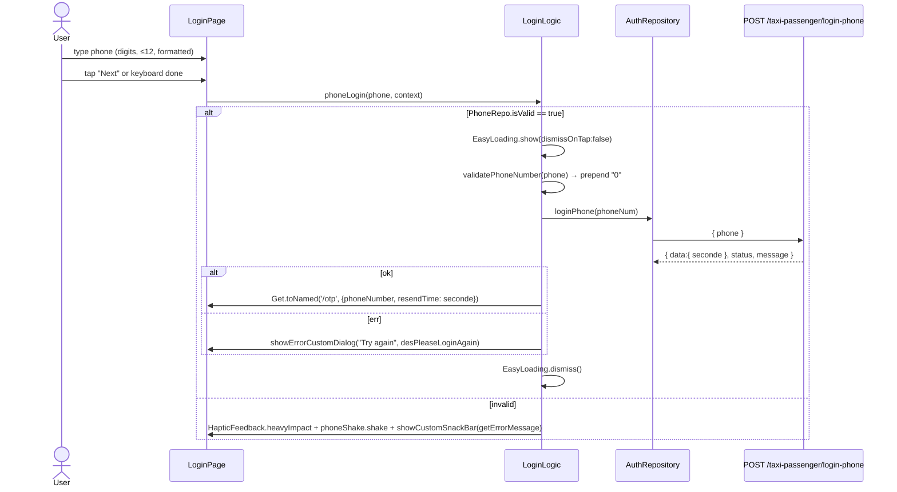
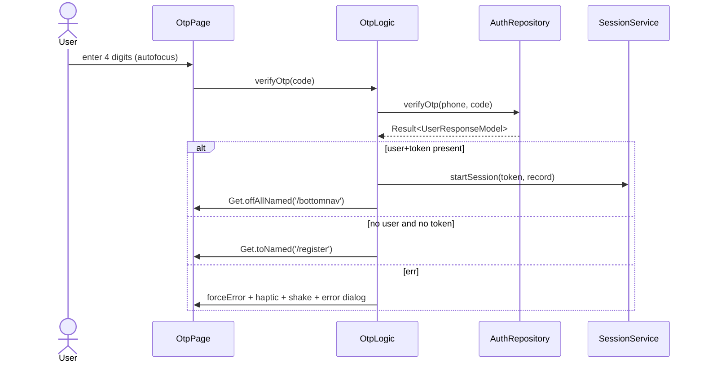
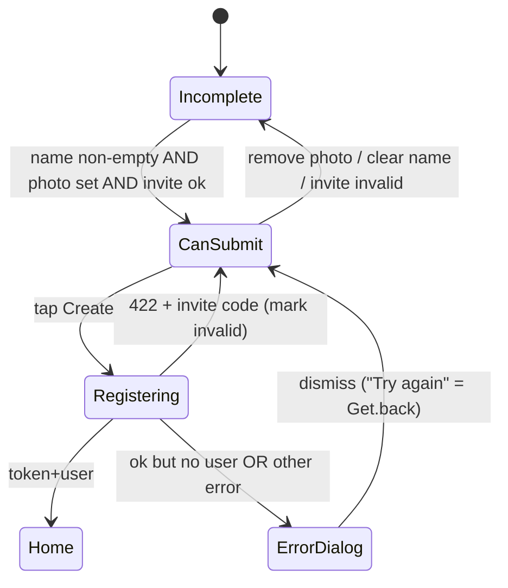

# Feature 01 — Authentication & Onboarding

**Screens:** Splash (`/splash`) · Login (`/login`) · OTP (`/otp`) · Register (`/register`)
**Audit status:** ✅ Complete — awaiting review
**Evidence:** all findings **[SRC]** unless tagged **[INFER]** / **[RUNTIME]**. No
screenshots or emulator were available, so visual "feel" claims are inferences
on verified code (see README §2).

---

## A. Feature Overview

- **Purpose:** authenticate a passenger by phone + OTP and, if new, complete a
  minimal profile; then enter the app shell (`/bottomnav`).
- **Actors:** new passenger (Splash → Login → OTP → Register) and returning
  passenger (Splash → Login → OTP → Home); also a re-entry path from logout/401
  straight to Login.
- **Outcome:** a session (token + sign-in record) stored by `SessionService`, and
  navigation to `/bottomnav`.
- **Entry points:**
  - App launch — `initialRoute: '/splash'` (`lib/routes/app_pages.dart:27`, `lib/routes/app_pages.dart:67`).
  - Logout — `AppLogic.logout()` → `/login` (`lib/app/logic.dart:140`).
  - Expired token (401) — `SessionService.handleUnauthorized()` → `/login` (`lib/services/session_service.dart:115-118`).
- **Exit points:** `/bottomnav` (success) from OTP or Register; `/login` (back from OTP).
- **Routes & DI:** `LoginBinding`, `OTPBinding`, `RegisterBinding`, `SplashBinding` (`lib/routes/app_pages.dart:66-95`).
- **Dependencies:**
  - `core/network/ApiClient` + `Result<T>` (`lib/core/network/result.dart`), `AuthDatasource`/`AuthRepository` (`lib/presentation/screens/login/data/…`).
  - `SessionService` (`lib/services/session_service.dart`), `TokenStore`, `SaveStoragePref`, `RemoveStoragePref`.
  - `AppLogic` for language (`lib/app/logic.dart:83-123`).
  - Invite-code check (D40) via `ReferralRepository` (`register/logic.dart:49-97`).
  - Debug bypass `DebugAuthBypass` (dev-only) (`lib/core/utils/debug_auth_bypass.dart`).
- **Main success path:** Splash → (token? → Home) | Login → OTP → (existing → Home | new → Register → Home).
- **Alternative paths:** invalid phone (shake+snackbar), OTP wrong (shake+dialog), OTP resend, back from OTP → Login, Register with/without photo, Register invite code valid/invalid/failed, debug login/bypass code (dev only).

---

## B. Screen Inventory

### B.1 Splash — `/splash`

- **File:** `lib/presentation/screens/splash_screen/view.dart` (logic `logic.dart`, state `state.dart`, binding `binding.dart`).
- **Layout hierarchy:**
  ```
  Scaffold(bg: background)
   └ SafeArea → Center
       └ Column(min)
           ├ SplashLogoBadge (96×96, radius 28, shadow primary@.40 blur40 y16, ScaleTransition pop Motion.base)
           ├ SizedBox(16)
           ├ Text(AppConstant.titleApp "PU TAXI", displayLarge + fontSize30 + letterSpacing3)
           ├ SizedBox(2)
           ├ Text(AppConstant.titleAppKhmer "ពូ តាក់ស៊ី", titleMedium, color primary)
           ├ SizedBox(34)
           └ SplashLoadingBar (120×5, track #E4E5EB, thumb 48 primary, sliding @Motion.ambient)
  ```
  [SRC] `splash_screen/view.dart:24-53`.
- **Scroll/keyboard:** none (no input; fixed centered column). SafeArea top/bottom applied.
- **Assets/icons:** `ImageAssets.brandMark` = `assets/launcher/launcher_passenger_1024.png` [SRC] `splash_screen/view.dart:99`.
- **Motion:** logo pop `Motion.base`; bar uses `applyAmbientMotion` (reduced-motion aware) [SRC] `splash_screen/view.dart:66-69,127`.

### B.2 Login — `/login`

- **File:** `lib/presentation/screens/login/view.dart` (logic `logic.dart`, state `state.dart`, binding `binding.dart`, `auth_language_toggle.dart`, `data/datasource/auth_datasource.dart`, `data/repository/auth_repository.dart`).
- **Layout hierarchy:**
  ```
  Scaffold(bg: background)
   └ SafeArea → Padding(fromLTRB 20,26,20,20)
       └ Column(stretch)
           ├ Row(spaceBetween): TaStepIndicator(steps3,current0) · AuthLanguageToggle (TaSegment EN/ខ្មែរ)
           ├ SizedBox(18)
           ├ Text(titleLogin "Login into your account", displayLarge)
           ├ SizedBox(6)
           ├ Text(desLogin, bodyMedium, color textSecondary)
           ├ SizedBox(18)
           ├ Text(phoneNumber label, bodyMedium w600 textSecondary)
           ├ SizedBox(8)
           ├ Obx → ShakeWidget → TaTextField(prefix "+855", hint enterPhoneNumber, digitsOnly, max12, CardNumberInputFormatter, action done)
           ├ SizedBox(16)
           ├ Obx → TaButton("Next")
           └ [debug only] ghost TaButton + caption
  ```
  [SRC] `login/view.dart:41-142`.
- **Scroll/keyboard:** **not scrollable** — a fixed `Column` in `Padding`; keyboard shrinks the body and can overflow (`login/view.dart:44-139`). **[INFER]** overflow risk on small screens/large text.
- **Assets/icons:** none (uses text + `+855` prefix).

### B.3 OTP — `/otp`

- **File:** `lib/presentation/screens/otp/view.dart` (logic `logic.dart`, binding `binding.dart`).
- **Args:** `phoneNumber`, `resendTime` (`otp/logic.dart:57-58`).
- **Layout hierarchy:**
  ```
  Scaffold(bg: background)
   └ SafeArea → Obx → Stack
       ├ Padding(fromLTRB 20,26,20,20) → Column(stretch)
       │   ├ Align(start): TaIconButton(back)
       │   ├ SizedBox(14)
       │   ├ Align(start): TaStepIndicator(steps3,current1)
       │   ├ SizedBox(18)
       │   ├ Text(otpVertification "OTP Verification", displayLarge)
       │   ├ SizedBox(6)
       │   ├ Text(desOtpVerification, bodyMedium textSecondary)
       │   ├ SizedBox(4)
       │   ├ Text(phoneNumber, titleMedium + fontSize15)
       │   ├ SizedBox(18)
       │   ├ Directionality(ltr) → ShakeWidget → Pinput(4, autofocus, smsRetriever, error/focus/submitted themes)
       │   ├ SizedBox(18)
       │   ├ OtpResendRow (label + timer pill | Send again)
       │   └ Spacer()
       └ if loading → LoadingWidget (full-screen overlay)
  ```
  [SRC] `otp/view.dart:50-155`.
- **Scroll/keyboard:** not scrollable; `autofocus: true` opens the keyboard immediately [SRC] `otp/view.dart:105`.
- **Assets/icons:** Material icons (`arrow_back_ios_new`).
- **Pin theme:** 58×64, radius 14, 26/w800, border 1.5; focused `primary`, error `error`/`errorBg`, submitted `primaryBg`/`primaryBorder` [SRC] `otp/view.dart:34-139`.

### B.4 Register — `/register`

- **File:** `lib/presentation/screens/register/view.dart` (logic `logic.dart`, state `state.dart`, binding `binding.dart`).
- **Layout hierarchy:**
  ```
  Scaffold(bg: background)
   └ SafeArea → GetBuilder<RegisterLogic> → Padding(20,26,20,20)
       └ Column(stretch)
           ├ Row(spaceBetween): TaIconButton(back) · AuthLanguageToggle
           ├ SizedBox(14)
           ├ Align(start): TaStepIndicator(steps3,current2)
           ├ SizedBox(18)
           ├ Expanded → SingleChildScrollView → Column(stretch)
           │   ├ Text(completeProfile "Complete Profile", displayLarge)
           │   ├ SizedBox(6)
           │   ├ Text(desRegister, bodyMedium textSecondary)
           │   ├ SizedBox(18)
           │   ├ Center → RegisterAvatarPicker (132×132 stack: 120 avatar + 38 camera badge)
           │   ├ SizedBox(6)
           │   ├ Text(tapToAddPhotoRequired, bodySmall textMuted, center)
           │   ├ SizedBox(18)
           │   ├ Text(fullName label)
           │   ├ SizedBox(8)
           │   ├ TaTextField(fullName, action done, onChanged → state + update())
           │   └ if inviteFeatureEnabled → InviteCodeField
           ├ SizedBox(12)
           └ TaButton("Create", isEnabled: canSubmitRegistration)
  ```
  [SRC] `register/view.dart:46-148`.
- **Scroll/keyboard:** scrollable body (`Expanded`+`SingleChildScrollView`); footer button pinned — good [SRC] `register/view.dart:72-141`.
- **Assets/icons:** Material `person`, `camera_alt`, `close`; `Image.file` for picked photo.
- **Avatar picker sheet:** `xShowModalBottomSheet(initialChildSize 0.4)` with two 180×120 bilingual cards "Gallery\nរូបថត" / "Take a Photo\nថតរូប" [SRC] `register/logic.dart:184-252`.

---

## C. User Flow & Interaction

### C.1 Splash → gate

1. App start → `SplashScreen` builds; `SplashLogic.onInit` → `_checkAuthorization` (`splash_screen/logic.dart:11-37`).
2. `SessionService.instance.getToken()` reconciles the token store vs the sign-in record; `await 1.delay()` (1s) (`logic.dart:27-28`).
3. token `null` → `Get.offAllNamed('/login')`; else → `/bottomnav`. Any exception → caught, `token = null` → login (`logic.dart:29-36`). **[SRC]** — no offline-specific branch, no visible error.

### C.2 Login → OTP



Evidence: `login/view.dart:99-117`, `login/logic.dart:47-80`, `login/data/datasource/auth_datasource.dart:23-31`.

### C.3 OTP → Home | Register

1. `OtpLogic.onInit` reads args, sets `secondsRemaining = timeResend`, starts 1s timer (`otp/logic.dart:53-64`).
2. `autofocus` opens keyboard; on 4 digits → `onCompleted: controller.verifyOtp` (`otp/view.dart:111`).
3. `verifyOtp`: if `DebugAuthBypass.accepts(code)` (dev) → debug session; else `AuthRepository.verifyOtp` → `POST /taxi-passenger/verify-phone-otp` (`otp/logic.dart:85-147`).
4. Result:
   - `data.user == null && data.token == null` → `Get.toNamed('/register')` (new user).
   - else → `SessionService.startSession(token, json)` → `Get.offAllNamed('/bottomnav')`.
   - err → `forceErrorPinPut = true`, haptic + shake, error dialog (`otp/logic.dart:130-142`).
5. Resend (`secondsRemaining == 0` → link): `resendCode()` sets 30s, calls `loginLogic.phoneLogin(phoneNumber, context)`, restarts timer (`otp/logic.dart:149-154`).
6. Back → `Get.back()` to Login (`otp/view.dart:66`).



Evidence: `otp/logic.dart:85-155`, `otp/view.dart:100-144`.

### C.4 Register → Home

1. Name typed → `state.passengerName = value; update()`; invite code debounced 450ms → `ReferralRepository.checkCode` (`register/logic.dart:70-97`).
2. `canSubmitRegistration` gates Create: name ≠ '' **and** photo ≠ null **and** invite status not invalid/checking (`register/view.dart:30-34`).
3. `passengerRegister` → `EasyLoading.show()` → `AuthRepository.register(fullName, phone, platform, profileImage, inviteCode)` → `POST /taxi-passenger/register` (multipart) (`register/logic.dart:107-146`).
4. ok with token+user → `SessionService.startSession` → `/bottomnav`; ok without → error dialog.
5. err 422 with invite code → mark `InviteCodeStatus.invalid` (server is final); other err → generic error dialog.
6. Photo picker: `showModal` → gallery/camera via `ImagePicker`; `removeProfileImage` clears; camera badge toggles (`register/logic.dart:160-252`).



Evidence: `register/view.dart:30-34,109-141`, `register/logic.dart:107-158`.

---

## D. Detailed UI Specification

Legend: **T** = centralized token; **H** = hardcoded/literal (redesign risk).

### D.1 Splash
- bg `TaColors.background` **T**; logo radius `28` **H**; shadow `primary@.40 blur40 y16` **H**; name 30/w800/ls3 **H** (displayLarge + overrides); Khmer subtitle `titleMedium` + `primary` **T**; bar track `#E4E5EB` **H**, thumb `primary` **T**, radius 99 **H**.
- No app bar, no buttons. The spec's "Skip →" link is intentionally not built [SRC] `splash_screen/view.dart:11-16`.

### D.2 Login
- bg `background` **T**; outer padding `fromLTRB(20,26,20,20)` **H** (matches the de-facto 20/26 shell).
- Type: title `displayLarge` **T**; subtitle `bodyMedium`+`textSecondary` **T**; phone label `bodyMedium`+w600 override **H**; field text 15 **H** (in `TaTextField`).
- `TaTextField`: h54 **H**, r14 **H**, border 1.5 (`primary` focused / `border` idle) **T**; prefix "+855" 15/w700 **H** with 1×22 rule **T**; hint 15 `textMuted` **T**; error caption 13 `error` **T** with reserved 18 min-height.
- `TaStepIndicator`: 26×5 dots, active `primary`, inactive `#DCDDE5` **T/H** (`ta_step_indicator.dart:41`).
- `AuthLanguageToggle`: `TaSegment` track `#E8EAF0` **H**, selected `surface`+`shadowSm` **T**.
- CTA: `TaButton` primary large 52/r16/16/w700, shadow `primary@.35 blur16 y6` **T**; `width` null → stretches (Column stretch).
- **Button hierarchy:** one primary CTA ("Next"); a developer-only ghost button appears under it when `DebugAuthBypass` is on.
- **Khmer/Latin:** all copy via `.tr`; the `+855` prefix and "EN/ខ្មែរ" are the only non-localized strings.

### D.3 OTP
- Same shell padding **H**; back icon button 42 drawn / 48 target **T**.
- Title `displayLarge` **T**; subtitle `bodyMedium textSecondary` **T**; phone `titleMedium`+fontSize15 **H** (redundant override).
- `Pinput` boxes: 58×64 **H**, radius 14 **H**, digits 26/w800 **T** (textPrimary), border 1.5 **T**; focused/error/submitted palettes **T**.
- Resend row: label `labelLarge`+w400+textSecondary **T**; timer pill bg `primaryBg` **T**, radius 99 **H**, text 14/w800 `primary` **T** (tabular figures); "Send again" `labelLarge`+`primary`+w700 **T**.
- Loading: `LoadingWidget` — white @.94, 64 spinner stroke5 `primary`/`primaryBorder` **T/H** (`loading_widget.dart:13`).
- **Missing per spec:** the "New here? Complete your profile →" link and the "Demo: type any 4 digits" line are intentionally not built [SRC] `otp/view.dart:17-24`.

### D.4 Register
- Same shell padding **H**; step indicator current 2.
- Avatar well 120×120 **H**, `surface`, circle, `shadowMd` **T**; placeholder `person` 44 `textMuted` **T**; camera badge 38 **H** `primary` with shadow `primary@.40 blur12 y4` **H**; icon 16 white **H**.
- Caption `bodySmall textMuted` **T**, text "Tap to add a photo (required)" [SRC] `register/view.dart:94-99`.
- Name label `bodyMedium`+w600 **H**; `TaTextField` as Login.
- `InviteCodeField`: label `bodyMedium`+w600 **H**; suffix spinner 18/stroke2 or `TaIconButton(qr_code_scanner)`; error text via `TaTextField.errorText` **T**; valid state shows `check_circle` 16 `success` + "Invited by @name" **T**; idle shows note `bodySmall textMuted` **T**.
- CTA `TaButton` primary large; disabled state `disabledBg`/`disabledText` **T**.
- **Button hierarchy:** one primary ("Create"); no ghost "Skip" (intentionally omitted — code wins over spec) [SRC] `register/view.dart:15-25`.

### D.5 Cross-screen tokens vs hardcoded

| Element | Source |
|---|---|
| Colors, type roles, shadows, control radii (buttons/fields/sheets) | **T** (`Ta*`) |
| Screen paddings, avatar sizes, field height, Pinput box size, splash bar, step dots, segment track, spinner backdrops | **H** |
| Phone validation copy, photo-picker labels, splash brand strings | **H** (not localized) |

### D.6 Accessibility (source-level)
- `TaIconButton` carries `semanticLabel` and grows hit area to 48 [SRC] `ta_icon_button.dart:38,60-77` — good.
- `TaStepIndicator` is purely visual (no semantics) — acceptable as decoration.
- Shake feedback is visual only; haptic + dialog accompany it, so the signal is not motion-only [SRC] `shake_widget.dart:60-68` — good.
- Text scaling respected but clamped to 1.3 [SRC] `root_main.dart:48-51`.
- `textMuted #9AA0B4` is used for captions/hints; on white this is low-contrast **[INFER]** (fails WCAG AA for small text) — **[RUNTIME]** contrast check owed.
- No `Semantics`/`liveRegion` announcement when validation fails **[INFER]**.

---

## E. UI States

| State | Splash | Login | OTP | Register |
|---|---|---|---|---|
| Initial/default | logo pop + bar | empty field, Next enabled | 4 empty boxes, autofocus, timer running | empty avatar/name, Create disabled |
| Loading | animated bar (not progress-bound) | `EasyLoading` modal | `LoadingWidget` overlay (in-screen) | `EasyLoading` modal |
| Success | → login/home | → OTP | → home / register | → home |
| Empty | n/a | n/a | n/a | Create disabled + "(required)" caption |
| Validation error | n/a | shake + snackbar (no inline error) | inline `forceErrorPinPut` + dialog | Create simply stays disabled (no message) |
| API error | falls back to login silently | "Try again" dialog (no real retry) | "Try again" dialog | "Try again" dialog; 422 invite → inline invalid |
| Offline / network loss | none specific | generic dialog | generic dialog | generic dialog |
| Disabled/unavailable | n/a | field disabled only while `debugLoggingIn` | n/a | Create disabled |
| Permission denied | n/a | n/a | n/a | camera/gallery handled by `ImagePicker` (no explicit denied UI) **[INFER]** |
| Repeated taps / double submit | n/a | Next stays enabled; `EasyLoading` modal likely absorbs taps **[RUNTIME]** | auto-submit idempotent-ish; no guard on resend spam | Create stays enabled; `EasyLoading` modal |
| Keyboard visible | none | **not scrollable → overflow risk** | fits (thin content) | scrolls; button pinned |
| Long text / unusual values | fixed strings | long name not applicable | long phone wraps? field non-scroll | long name scrolls; Khmer long name ok |

**States that appear missing:** inline field error on Login; a real retry action;
offline detection/message anywhere in auth; an explicit "photo optional" path
(business rule makes photo required); success feedback/toast on resend.

---

## F. UX Evaluation — Issues

Severity per README §3. "Confirmation" = **[SRC]** (confirmed in code) or
**[RUNTIME]** (needs a device pass).

### F01-01 — "+855" prefix is display-only; submission prepends "0"
- **Screen/component:** Login — `TaTextField(prefix: '+855')` + `validatePhoneNumber`.
- **Observed:** the field shows `+855` but the submitted number is normalized by prepending `0` when missing (`login/logic.dart:112-118`), so a user typing `12 345 678` sends `012345678`.
- **Why problem:** the UI implies an international number; the wire format is a Cambodian local number. Users entering a real `+855…` number create a malformed value.
- **Impact:** failed/duplicate OTP sends, confusion.
- **Severity:** High. **Evidence:** `login/view.dart:87`, `login/logic.dart:112-119` **[SRC]**.
- **Recommended:** make the prefix reflect the actual expected format (e.g. `0`), or strip/normalize `+855` explicitly; align display and wire format. *(Proposed; business logic preserved — normalization stays, but becomes honest.)*

### F01-02 — Two contradicting phone validators; error text off-by-one
- **Screen/component:** Login — `PhoneRepo.isValid` vs unused `LoginLogic.validatePhone`.
- **Observed:** `PhoneRepo.isValid` accepts 8–15 digits; `validatePhone` (never called) demands ≥10; message says "between 9 and 15 digits" while the check is `< 8 || > 15` (`phone_validate_helper.dart:18-19`).
- **Impact:** inconsistent rules confuse maintenance and can mis-message users.
- **Severity:** Medium. **Evidence:** `login/logic.dart:37-45`, `phone_validate_helper.dart:18-21` **[SRC]**.
- **Recommended:** single validator; correct the copy; delete dead `validatePhone`. *(Engineering.)*

### F01-03 — Input cap (12) contradicts validator ceiling (15)
- **Observed:** `LengthLimitingTextInputFormatter(12)` (`login/view.dart:94`) vs validator allowing 15.
- **Severity:** Low. **Evidence:** as cited. **Recommended:** one limit.

### F01-04 — `state.isLoading` never set in `phoneLogin`
- **Observed:** `phoneLogin` uses `EasyLoading` but never sets `state.isLoading`; the field's `enabled: !isLoading` guard is therefore always true (`login/logic.dart:47-80`, `login/view.dart:81`).
- **Severity:** Low. **Recommended:** drive the field/button from one loading flag.

### F01-05 — Invalid-phone snackbar shows only a title; message dropped
- **Observed:** `showCustomSnackBar(title: getErrorMessage(), message: "")`; the widget only renders `title` (the message `Text` is commented out) and paints an error border (`custom_snackbar_widget.dart:20-59`).
- **Severity:** Medium. **Recommended:** show a concise inline error under the field (TaTextField already supports `errorText`) and/or a real message in the toast.

### F01-06 — Phone validation copy is hardcoded English
- **Observed:** `PhoneRepo` returns English literals, not `.tr` (`phone_validate_helper.dart:13-19`); the rest of auth is localized.
- **Severity:** Medium. **Recommended:** localize validation messages.

### F01-07 — Next has no in-progress state; double-submit possible
- **Observed:** `TaButton("Next")` `isEnabled` only checks `debugLoggingIn`; `phoneLogin` fires on tap and on keyboard done (`login/view.dart:99-117`).
- **Severity:** Medium. **Recommended:** set `isLoading` on the button and guard re-entry.

### F01-08 — No inline error on Login
- **Observed:** invalid input triggers shake+snackbar, never the field's own `errorText` (`login/view.dart:73-107`).
- **Severity:** Medium. **Recommended:** use `TaTextField.errorText`.

### F01-09 — Login screen is not scrollable
- **Observed:** fixed `Column` inside `Padding`, no scroll view (`login/view.dart:44-139`); OTP is likewise non-scrollable.
- **Impact:** keyboard + large text (up to 1.3×) can overflow.
- **Severity:** High. **Evidence:** code **[SRC]**; visual **[INFER]**. **Recommended:** wrap in a scroll view with a `Spacer`-free bottom action.

### F01-10 — Copy diverges from the design spec and is ungrammatical
- **Observed:** title "Login into your account" (spec: "Welcome back"), `desLogin` "Please Input your phone number for login into your account", `desRegister` "Please fill out the to unlock full access.." (`app_locale.dart:3-5,228`).
- **Severity:** Low. **Recommended:** copy pass (localized).

### F01-11 — Language toggle triggers a global EasyLoading spinner + 0.5s delay
- **Observed:** `AuthLanguageToggle` → `AppLogic.toggleLanguage` → `changeLanguage` shows `EasyLoading` and `await 0.5.delay()` (`app/logic.dart:93-123`).
- **Severity:** Low/Medium. **Recommended:** instant locale switch without a modal spinner.

### F01-12 — `LoginLogic` is required by OTP and Register but not registered on their routes
- **Screens:** OTP resend calls `loginLogic.phoneLogin`; Register reads `loginLogic.state.phoneNumber.value`.
- **Observed:** `OTPBinding`/`RegisterBinding` register `AuthDatasource`/`AuthRepository`/their own logic only; `OtpLogic`/`RegisterLogic` do `Get.find<LoginLogic>()` (`otp/binding.dart`, `register/binding.dart`, `otp/logic.dart:36-37`, `register/logic.dart:54-55`).
- **Why problem:** correctness depends on the Login route still being in the navigator stack; a deep link / route disposal would make `Get.find<LoginLogic>` throw.
- **Impact:** potential crash on OTP resend / registration.
- **Severity:** High. **Evidence:** **[SRC]** code; **failing condition [RUNTIME]** unresolved. **Recommended:** pass phone via args into a shared auth controller or session; register a single shared auth dependency.

### F01-13 — OTP success uses AND-of-nulls; partial responses start a tokenless session
- **Observed:** `if (data.user == null && data.token == null) → register; else startSession(token, ...) → home` (`otp/logic.dart:119-128`). A response with a user but no token takes the "signed-in" branch, stores a null token, and navigates Home.
- **Severity:** High. **Recommended:** require **both** token and user for success; otherwise treat as failure.

### F01-14 — `otp/logic.dart` assigns `args['phoneNumber']` without a null guard
- **Observed:** `phoneNumber = args['phoneNumber']` into a non-nullable `late String` (`otp/logic.dart:57`).
- **Severity:** Low. **Recommended:** validate args; fall back to login.

### F01-15 — Errors are blocking dialogs whose "Try again" only closes the dialog
- **Observed:** `showErrorCustomDialog(..., () { Get.back(); })` in Login/OTP/Register — the label reads "Try again" but performs no retry (`login/logic.dart:62-71`, `otp/logic.dart:134-142`, `register/logic.dart:148-158`).
- **Impact:** user must repeat the whole action; the button name overpromises.
- **Severity:** High. **Recommended:** make it retry the failed call, or relabel to "OK"/"Close".

### F01-16 — No offline/network-specific messaging in auth
- **Observed:** all failures collapse to "Try again"/"Something went wrong" (`app_locale.dart:230-232`).
- **Severity:** Medium. **Recommended:** detect offline and say so.

### F01-17 — Photo is mandatory with no Skip; only a small caption explains it
- **Observed:** `canSubmitRegistration` requires `profileImage != null`; caption "(required)"; no Skip (`register/view.dart:30-34,94-99`).
- **Why problem:** forces camera/gallery + a permission before account creation — the highest-friction point in onboarding.
- **Impact:** drop-off at sign-up.
- **Severity:** High. **Evidence:** [SRC]. **Recommended:** keep the backend rule, but consider making photo optional at the product level or, if it must stay, explain the benefit and provide a clear default avatar path. *(Flag: business rule to confirm — code currently wins over spec, per `register/view.dart:15-25`.)*

### F01-18 — Photo-picker sheet is bilingual hardcoded
- **Observed:** "Gallery\nរូបថត" / "Take a Photo\nថតរូប" literals (`register/logic.dart:214,239`).
- **Severity:** Low/Medium. **Recommended:** localize; single language.

### F01-19 — Register gate has no message when disabled
- **Observed:** Create stays disabled with no reason shown beyond the photo caption; name rule (non-empty) is undisclosed (`register/view.dart:137-141`).
- **Severity:** Medium. **Recommended:** inline hints for each unmet requirement.

### F01-20 — Camera badge on avatar is below the 48px tap target
- **Observed:** badge is a 38×38 `TaPressable` with no min target (`register/view.dart:197-217`) vs the 48 floor used by `TaIconButton`.
- **Severity:** Low. **Recommended:** grow the hit area to 48.

### F01-21 — Invite field is on in production while the backend lacks the routes
- **Observed:** `inviteFeatureEnabled = true` always, and the datasource comment says the real API has none of these routes yet (`invite_feature.dart:4-9`), so every typed code resolves to "Couldn't check the code".
- **Severity:** Medium. **Recommended:** hide/disable the field until the backend endpoint exists, or present it as "optional, checked at sign-up" without a failing inline error.

### F01-22 — Splash shows "PU TAXI", not the Taarraa brand
- **Observed:** `AppConstant.titleApp = 'PU TAXI'`, subtitle `'ពូ តាក់ស៊ី'` (`app_constant.dart:14-18`) while the redesign targets "TAARRAA / តារា · Taxi" (`docs/ux-redesign/03-screen-redesign.md:20-23`).
- **Severity:** Medium (branding inconsistency with the intended redesign). **Recommended:** align brand strings with the target identity.

### F01-23 — Splash `SplashLogic` may be constructed twice
- **Observed:** `Get.put(SplashLogic())` in the widget's field initializer (`splash_screen/view.dart:20`) plus `SplashBinding`'s `Get.lazyPut` (`splash_screen/binding.dart:7`).
- **Severity:** Low. **Recommended:** rely on the binding only.

### F01-24 — `desRegister` copy is broken/awkward English
- **Observed:** "Please fill out the to unlock full access.." (`app_locale.dart:228`).
- **Severity:** Low. **Recommended:** rewrite.

### F01-25 — Register `GetBuilder` + manual `update()` mixes patterns
- **Observed:** `RegisterPage` uses `GetBuilder<RegisterLogic>` while other auth screens use `Obx`; `onChanged` mutates state then calls `logic.update()` (`register/view.dart:49,117-120`).
- **Severity:** Low. **Recommended:** standardize on one reactive pattern.

---

## G. Flutter Implementation Review

**Architecture.**
- GetX screen-per-folder with route bindings; `AuthDatasource`→`AuthRepository`→logic is a clean, testable split (constructor injection supported: `LoginLogic({repository})`, `OtpLogic({repository, loginLogic})`, `RegisterLogic({repository, loginLogic, referralRepository})`) [SRC].
- **Duplicated registration:** `AuthDatasource`/`AuthRepository` are `lazyPut` separately in `LoginBinding`, `OTPBinding`, `RegisterBinding` (`login/binding.dart:9-10`, `otp/binding.dart:9-10`, `register/binding.dart:10-11`). Works, but three registrations of the same pair.

**Coupling / lifecycle (see F01-12, F01-13).**
- OTP and Register reach across into `LoginLogic` for state (`phoneNumber`) and behaviour (resend). This is the main correctness risk in the feature.
- Cross-layer coupling also exists in `RegisterLogic`: it imports the invite flow's datasource/repository directly (`register/logic.dart:4-8`) rather than an abstracted service.

**Logic in UI.**
- Mostly clean: `canSubmitRegistration` is a top-level pure function (good, testable) (`register/view.dart:30-34`). The view calls `logic.update()` after mutating state — a minor leak of the reactive mechanism into the view.

**Dead / unused code.**
- `LoginLogic.validatePhone` unused (`login/logic.dart:37-45`).
- `SplashState` fields unused by the splash (`splash_screen/state.dart`).
- Two route constants (`MYBOOKING`, `WHERETOGO`) and two debug-only branches (`DebugAuthBypass`) — the latter intentional.

**Hardcoded styles / tokens.**
- Auth screens largely use tokens for color/type but hardcode all spacing (`20/26/18/16/8/14`), avatar/field/Pinput dimensions, splash bar, and several neutrals (`#E4E5EB`, `#DCDDE5`, `#E8EAF0`). See design_system_inventory DS-01/DS-11/DS-14.

**Loader inconsistency.**
- Four different loading presentations across four screens: splash bar, `EasyLoading` (Login/Register), in-screen `LoadingWidget` (OTP). Ties to DS-07.

**Rebuilds / widget trees.**
- `Obx(() => ShakeWidget(...TaTextField...))` in Login rebuilds the field subtree on `state` changes; acceptable given small state, but the `Obx` only needs to wrap `enabled`, not the whole field.
- `Pinput`'s `forceErrorPinPut` is observed via `Obx` at the Stack level (`otp/view.dart:53`), rebuilding the whole screen on error toggles.

**Responsiveness / overflow.**
- Login and OTP are non-scrollable fixed columns (**F01-09**) — the main responsive risk.
- `.d` diagonal scaling is **not** used in auth (fine — auth is simple), but combined with the clamp at 1.3× and fixed heights (h54 field, 64 pin), large-text overflow is plausible **[INFER]**.

**Testability.**
- Constructor injection and pure functions make the auth logic unit-testable; the string-keyed `Get.arguments` map (`otp/logic.dart:51-58`) is the weak point (no typed args).

---

## H. Future Modernization Opportunities

> All items are **Proposed**, not existing behaviour. Business rules (OTP-based
> sign-in, register-with-photo, invite-code server validation) are preserved.

### H.1 UX
1. **Honest phone input.** Show the format the server expects (F01-01); add live formatting and inline validation (F01-02/08).
2. **Real error recovery.** Make the error action retry the failed request, and add offline-specific copy (F01-15/16).
3. **Reduce onboarding friction.** Revisit the mandatory-photo gate; if it stays, add a clear "why" and a usable default avatar path (F01-17).
4. **Explicit vs implicit registration.** Keep the backend-driven "new user → Register" branch, but add a visible transition so the jump isn't surprising (spec's "New here?" link is currently omitted).
5. **Single loader language.** One overlay style across all four screens (DS-07).

### H.2 UI
1. **Apply the target brand** on Splash ("TAARRAA"/"តារា · Taxi") (F01-22).
2. **Introduce spacing tokens** in auth (`TaSpacing`) and replace literal paddings (DS-01).
3. **Tokenize neutrals** (`#E4E5EB`, `#DCDDE5`, `#E8EAF0`) and control dimensions (field height, Pinput size, avatar) (DS-11).
4. **Unify the auth header** — every auth screen renders step indicator + language toggle; make it a shared `AuthHeader` widget.
5. **Localize the photo sheet and validation copy** (F01-06/18).

### H.3 Engineering
1. **Break cross-controller coupling.** Introduce an `AuthSession` (or pass args) so OTP/Register don't depend on `LoginLogic` existing (F01-12); add a typed args model instead of `Get.arguments` string keys (F01-14).
2. **Fix the OTP success predicate** to require token **and** user (F01-13).
3. **Consolidate auth DI** into one binding and delete dead code (`validatePhone`, `SplashState`) (F01-23).
4. **Standardize reactive pattern** (`Obx` everywhere or `GetBuilder` everywhere) (F01-25).
5. **Accessibility pass:** inline error `Semantics`, contrast-check `textMuted` on white, and 48px minimum targets for custom controls (F01-20).

---

## Appendix — confirmed vs unresolved

**Confirmed [SRC]:** F01-01…F01-08, F01-10, F01-11, F01-13, F01-14, F01-15,
F01-16, F01-17, F01-18, F01-19, F01-20, F01-21, F01-22, F01-23, F01-24, F01-25.

**Needs runtime verification [RUNTIME]:**
- F01-09 overflow on device (small screen / 1.3× text).
- F01-12 whether `Get.find<LoginLogic>()` actually throws on OTP resend / Register
  in the normal navigation stack (GetX lifecycle).
- F01-05/F01-19 perceived clarity of the disabled/error feedback on a device.
- D.6 `textMuted` contrast ratio.
- Keyboard behavior and the exact `EasyLoading` visual.

**Open product questions:**
- Is the mandatory photo a real requirement or an implementation artefact?
- Should the "New here?" register affordance exist (spec) given the automatic branch (code)?
- Is the invite code meant to be visible in production before its backend endpoints ship?
